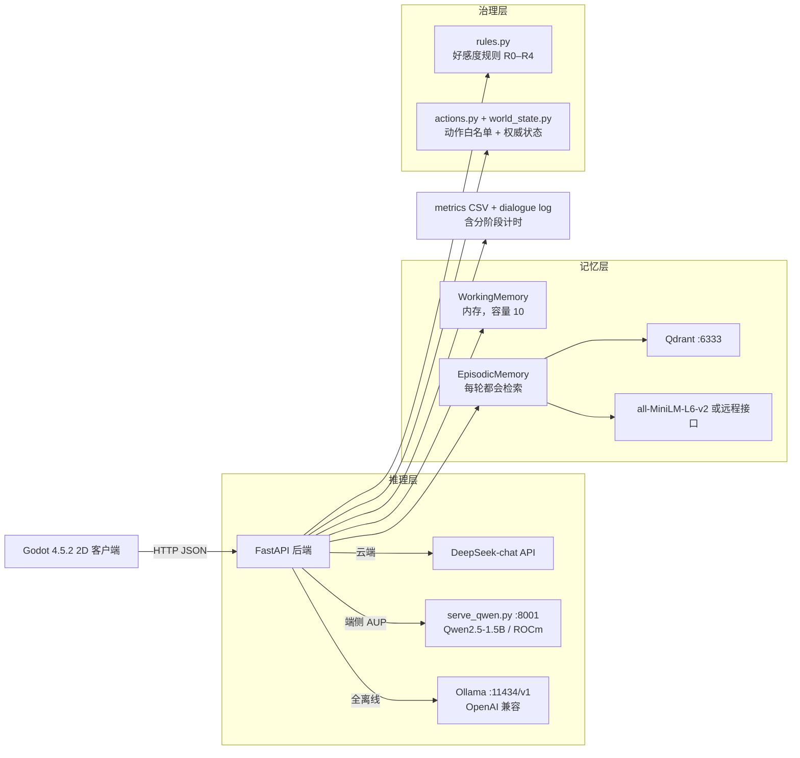

# 系统架构

## 总览



## 三层治理：模型只能提议，后端裁决

这是本项目与"能对话的 NPC demo"最本质的区别。

| 层 | 文件 | 谁有权改状态 | 模型能做什么 |
|---|---|---|---|
| 好感度 | `backend/rules.py` | 后端规则 R0–R4（有限性、单轮上下限、正向需情感证据、0–100 边界） | 只能给出一个变化量提议，被裁剪或拒绝都记进 CSV |
| 世界状态 | `backend/world_state.py` | 只有 `actions.py` 能写 | 只能用 `<<ACTION {json}>>` 提议白名单内的动作；`grant_gold` 等直接 `forbidden` |
| 位置 | `backend/world_state.py` | 客户端拥有移动，后端裁决「是否允许」 | 上报越界或单步超过 `max_step`（默认 5）一律拒绝并留审计 |
| 记忆 | `backend/agents.py` | 按 `(NPC, 玩家)` 二元组隔离 | 无法跨玩家读取；检索与写入都按该键归属 |

动作白名单（`backend/actions.py`）：

| 动作 | 前置条件 |
|---|---|
| `accept_quest` | 任务存在且状态为 available |
| `complete_quest` | 任务为 active，且背包满足所需物品；奖励金额由任务定义，**不接受调用方指定** |
| `transfer_item` | 来源持有足够数量，单次 ≤ 5 |

开关 `ACTION_PROPOSAL` 默认 **off**，保证已有实验的 prompt 与行为可复现。
详见 [GOVERNANCE.md](GOVERNANCE.md)。

## 三条推理路径共用一套后端代码

`backend/config.py` 通过环境变量选择 provider、模型与地址，`agents.py` 一行不改：

| 路径 | `LLM_PROVIDER` | `LLM_BASE_URL` | 说明 |
|---|---|---|---|
| 云端 | `deepseek` | `https://api.deepseek.com` | 直连官方 API |
| 端侧 AUP | `openai` | `http://127.0.0.1:8001/v1` | 本地 `serve_qwen.py` 提供 OpenAI 兼容接口 |
| 全离线 | `openai` | `http://127.0.0.1:11434/v1` | Ollama，模型 `qwen2.5:1.5b` |

端侧为什么不用 vLLM：PyPI 的 vLLM wheel 是纯 CUDA 构建，在 ROCm 机器上安装会把 torch
换成 CUDA 版并导致 GPU 不可用。`serve_qwen.py` 只依赖镜像自带的 torch + transformers，
对 1.5B 足够。详见 [TROUBLESHOOTING.md](TROUBLESHOOTING.md)。

## 演示形态：客户端与后端分处两地

JupyterHub 平台的后端端口在反向代理后面，需要登录 Cookie。`tools/local_proxy.py` 在本地
起一个只监听 `127.0.0.1` 的转发代理补上 Cookie —— 公网没有入口。细节见
[LOCAL_CLIENT_REMOTE_BACKEND.md](LOCAL_CLIENT_REMOTE_BACKEND.md)。

## 实验开关

| 开关 | 取值 | 影响 |
|---|---|---|
| `MEMORY_MODE` | `off` | 不创建 `MemoryManager`，且**每轮重建 Agent** —— 连同轮上下文都不保留 |
| | `on` | 启用 WorkingMemory + EpisodicMemory/Qdrant，跨轮保留 |
| `MODEL_PROFILE` | `deepseek` / `aup_local` / 自定义 | 切换推理路径，不改业务代码 |
| `ACTION_PROPOSAL` | `off`（默认）/ `on` | 是否允许模型提议世界动作 |
| `EMBED_MODEL_TYPE` | `dashscope` / `local` | 记忆用远程还是本地 embedding（**这个选择对延迟影响最大**） |

## 记忆读写实况（与直觉不同的三点）

1. **对话只写工作记忆。** `_save_conversation_to_memory()` 显式传 `auto_classify=False`，
   两条记录都落在 working（容量 10、进程内），既不落 SQLite 也不落 Qdrant。
   之所以显式关掉：默认的 `auto_classify=True` 会把含「记得」等关键词的内容塞进 episodic，
   而 episodic 的向量存储是**全玩家共享**的，会造成跨玩家泄露。
2. **工作记忆的检索是本地 TF-IDF，不是向量检索。** 它依赖空格与词边界分词，对中文失效，
   必须打补丁才召回得到（`patches/apply_working_memory_fix.py`）。
3. **episodic 检索每轮都会执行**（哪怕集合是空的）。它不是"初始化依赖"——
   实测它在每轮里都会占掉一段固定时间；配置不当会明显放大（见 TROUBLESHOOTING 坑 12）。
   见 [../experiments/STAGE_TIMING.md](../experiments/STAGE_TIMING.md)。

## 分阶段计时

`chat()` 把每轮拆成 5 段并写进 metrics CSV：

```
retrieve → context → generate → action → affinity → save
```

这是本项目定位"开销到底在哪"的关键手段：端到端只看到 3 倍差异时，拆开才发现差异在
`retrieve`；再拆到子调用（`tools/bench_episodic.py`）才找到真正原因。
见 [../experiments/STAGE_TIMING.md](../experiments/STAGE_TIMING.md)。

## 数据采集

后端每轮写入两处，互为印证：

- `backend/logs/metrics_YYYY-MM-DD.csv` —— 服务端耗时、`memory_recall_count`、好感度前后值、
  `prompt_chars`/`reply_chars`、5 个阶段耗时、失败标记
- `backend/logs/dialogue_YYYY-MM-DD.log` —— 逐轮对话、检索到的记忆原文、好感度变化原因

客户端另有一份端到端延迟（含网络），与上面两份汇总后进入 `experiments/`。
矩阵实验由 `tools/run_matrix.py` 自动跑，脚本索引见 [../tools/README.md](../tools/README.md)。
