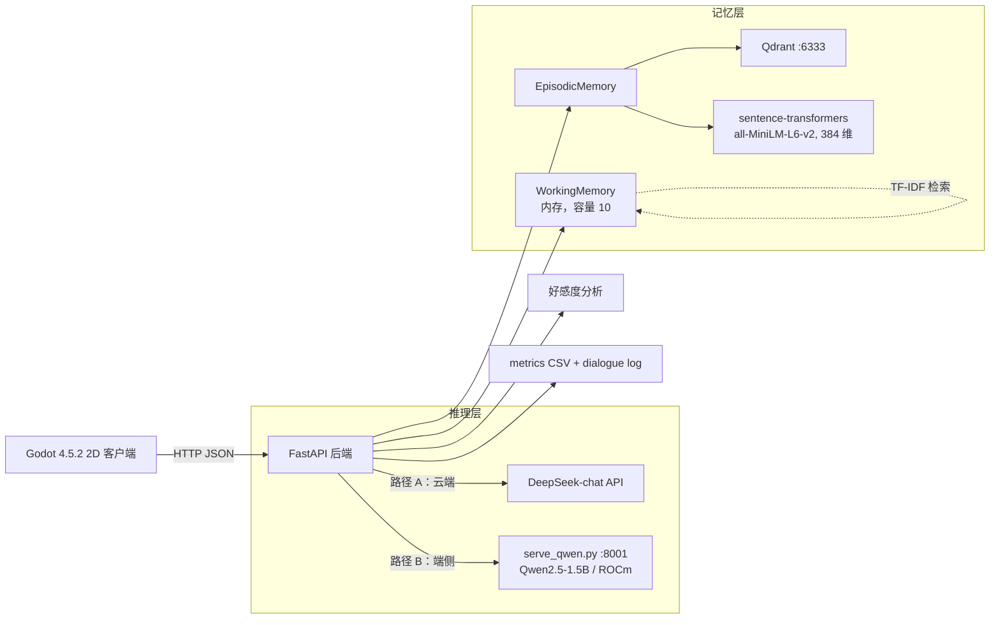

# 系统架构

## 两条推理路径共用一套后端代码

`backend/config.py` 通过环境变量选择 provider、模型与地址,`agents.py` 不变:

| 路径 | `MODEL_PROFILE` | `LLM_BASE_URL` | 说明 |
|---|---|---|---|
| A 云端 | `deepseek` | `https://api.deepseek.com` | 直连官方 API |
| B 端侧 | `aup_local` | `http://127.0.0.1:8001/v1` | 本地 `serve_qwen.py` 提供 OpenAI 兼容接口 |

端侧为什么不直接用 vLLM:PyPI 的 vLLM wheel 是纯 CUDA 构建,在 ROCm 机器上安装会把 torch 换成 CUDA 版并导致 GPU 不可用。`serve_qwen.py` 只依赖镜像自带的 torch + transformers,对 1.5B 模型足够。详见 [TROUBLESHOOTING.md](TROUBLESHOOTING.md)。

## 实验只改两个开关

| 开关 | 取值 | 影响 |
|---|---|---|
| `MEMORY_MODE` | `off` | 不创建 `MemoryManager`,并且每轮重建 Agent —— 连**同轮**上下文也不保留 |
| | `on` | 启用 WorkingMemory(内存)+ EpisodicMemory/Qdrant,跨轮保留 |
| `MODEL_PROFILE` | `deepseek` / `aup_local` | 切换推理路径,不改任何业务代码 |

## 记忆写入与检索的实际路径

值得注意的两点(与直觉不同):

1. **对话只写工作记忆。** `_save_conversation_to_memory()` 用 `memory_type="working"`,因此既不落 SQLite 也不落 Qdrant。Qdrant 在实验里只是 `EpisodicMemory.__init__` 的硬依赖,并没有真正参与检索。
2. **工作记忆的检索是本地 TF-IDF,不是向量检索。** 它依赖空格与词边界分词,对中文失效,必须打补丁才能召回(CJK `patches/apply_working_memory_fix.py`)。

## 数据采集

后端每轮写入两处,互为印证:

- `backend/logs/metrics_YYYY-MM-DD.csv` —— 服务端耗时、`memory_recall_count`、好感度前后值、失败标记
- `backend/logs/dialogue_YYYY-MM-DD.log` —— 逐轮对话、检索到的记忆原文、好感度变化原因

客户端另有一份端到端延迟(含网络),与上面两份汇总后进入 `experiments/`。
