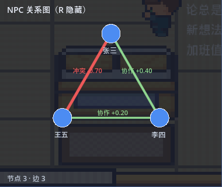

# NPC ↔ NPC 社会关系图

## 为什么是"图",而不是再加一个好感度

`relationship_manager` 里只有 **NPC ↔ 玩家** 的一维好感度。要观察「两个 NPC 之间是朋友还是
对手、这个关系怎么随事件演化」，需要的是**边**：每对 NPC 一条，由事件驱动，带证据链。

## 数据结构

| 字段 | 说明 |
|---|---|
| `a` / `b` / `pair` | 无向边（3 个 NPC → 3 条边） |
| `strength` | **唯一连续量**，范围 −1…1 |
| `type` | 由强度派生：`friend` ≥0.5、`coop` ≥0.2、`neutral` >−0.2、`rival` ≤−0.2、`conflict` ≤−0.5 |
| `evidence` | 最近 20 条：时间 / 事件 / 增量 / 之后强度 / 备注 |
| `updated_at` | 最后变动时间 |

**类型是从强度派生出来的**，这样事件只需要加减一个数，不会出现"类型和强度互相矛盾"的状态。

## 事件规则

| 事件 | 增量 | 用途 |
|---|---:|---|
| `help` | +0.30 | 帮对方做事 |
| `cooperate` | +0.20 | 协作 |
| `praise` | +0.10 | 公开称赞 |
| `ignore` | 0 | 无互动 |
| `compete` | −0.30 | 争夺同一任务 |
| `conflict` | −0.40 | 正面冲突 |
| `betray` | −0.60 | 背约 |

一次事件可以涉及多个 NPC（例如三个人一起争），此时**所有两两组合**都会受影响：
3 个 NPC 会同时改动 3 条边。强度截断在 ±1。

## 实测：`scenarios/rivalry.yaml`

场景脚本（4 轮）驱动了 4 次关系事件：

| 时间 | 事件 | 增量 | 之后强度 | 备注 |
|---|---|---:|---:|---|
| 19:35:02 | `compete` | −0.3 | −0.3 | 争夺同一任务名额 |
| 19:35:03 | `conflict` | −0.4 | −0.7 | 公开互相指责 |
| 19:35:04 | `help` | +0.3 | −0.4 | 张三帮王五看了设计稿 |
| 19:35:05 | `cooperate` | +0.2 | **−0.2** | 李四促成分工 |

最终三对关系（`GET /relations`）：

```
张三↔李四   coop    0.2    1 条证据
张三↔王五   rival  -0.2    4 条证据    ← 竞争→冲突→帮助→协作，净 −0.2
李四↔王五   coop    0.2    1 条证据
```

**关键在于：关系只由事件决定，模型在对话里说什么都不影响它。** 同一场景重跑，关系轨迹
完全一致（事件是确定性的），这也是它可作实验条件的原因。

### 一个被实测暴露的 bug

第一版跑出来时，`张三↔王五` 是 `neutral` 而不是 `rival` —— 因为
−0.3 −0.4 +0.3 +0.2 在浮点下是 `-0.19999999999999998`，落在阈值 `≤ -0.2` 之外。
修法：`type_of()` 先四舍五入到 3 位，`apply_event` 每次累加后也四舍五入。
已补回归测试 `test_float_accumulation_keeps_boundary`。

> 这类 bug 只有真跑才会暴露，纯看代码不会发现。

## REST API

| 方法 | 路径 | 说明 |
|---|---|---|
| GET | `/relations?include_evidence=true` | 所有边 + 统计 |
| GET | `/relations/graph` | **节点 + 边**，给界面渲染用 |
| POST | `/relations/event` | `{kind, actors[], weight?, note?}` 驱动一次事件 |
| POST | `/relations/reset` | 清空回中立 |
| GET | `/relations/neo4j?read=true` | Neo4j 镜像状态；`read=true` 读回验证 |
| POST | `/relations/sync` | 把当前图镜像到 Neo4j |

## Neo4j 镜像（可选）

### 为什么是"可选"

3 个 NPC 只有 3 条边，**内存图才是权威**，用图数据库存是牛刀。镜像的真实价值只有两个：

1. 用 Cypher 做多跳查询（"谁和谁是一条线上的"），内存版没实现；
2. 演示时直接开 Neo4j Browser 看关系网络，比看 JSON 直观。

所以：**没配凭据就完全不启用**，`/relations/sync` 会安静地返回"未启用"，不影响任何其它功能。

### 本机现状与开启步骤

本机 Neo4j 是 `E:\Software\neo4j\neo4j-community-4.4.46` 的 **Windows 服务**。
4.4 起用户凭据存在 `data\databases\system` 库里（哈希），**密码无法找回**，只能重置或关闭认证。

这里选的是**关闭认证**（仅本机开发），**已完成并验证**（2026-11-01）：

| 检查 | 结果 |
|---|---|
| Neo4j 版本 | 4.4.46 community（Windows 服务） |
| 驱动版本 | `neo4j` 6.4.1（与 4.4 兼容，实测可连） |
| 无凭据 HTTP | 200（认证已关闭） |
| 写读回环 | 通过 |
| 关系图镜像 | **3 节点 / 3 边** 写入成功，读回一致 |

执行步骤（留档）：

```powershell
# 1) 已改好：conf 第 27 行取消注释
#    E:\Software\neo4j\neo4j-community-4.4.46\conf\neo4j.conf
dbms.security.auth_enabled=false

# 2) 必须用【管理员】PowerShell 重启服务（普通权限会报"无法打开服务"）
Restart-Service neo4j

# 3) 验证（不带凭据应返回 200）
python tools/check_neo4j.py

# 4) 让后端认识这个模式
$env:NEO4J_AUTH='none'
```

另一条路是保留认证并重置密码（会重建 `system` 库里的用户/角色，业务库数据不受影响）：
停服务 → 移走 `data\databases\system` 与 `data\transactions\system` →
`bin\neo4j-admin.bat set-initial-password 新密码` → 起服务。

### 镜像写入的 Cypher

```cypher
UNWIND $nodes AS n MERGE (x:NPC {id:n.id}) SET x.label = n.label
UNWIND $edges AS e MATCH (a:NPC {id:e.a}) MATCH (b:NPC {id:e.b})
MERGE (a)-[r:RELATES]->(b) SET r.strength=e.strength, r.type=e.type, r.updated_at=e.updated_at
```

## 验证证据

`tools/probe_relations.py` 一次跑出 10 项检查，全部通过：

```
[PASS] 复位后全部中立
[PASS] compete → 强度 -0.30 / rival
[PASS] conflict → 强度 -0.70 / conflict
[PASS] help → 强度 -0.40 / rival（回暖）
[PASS] 证据链累计 3 条
[PASS] graph 有 3 节点 3 边
[PASS] Neo4j 写入成功  nodes=3 edges=3
[PASS] Neo4j 读回图非空（3 条边 / 3 个节点）
```

原始输出：`experiments/governance/relations_check.txt`

## Godot 关系面板

`godot/scripts/relations_panel.gd`，由 `godot/scripts/main.gd` 在 `_ready()` 里挂载
（不改动任何场景文件，也不干预对话与移动逻辑）。

| 项 | 值 |
|---|---|
| 位置 | 右上角，380×320，半透明底 |
| 数据 | 每 5 秒 `GET /relations/graph` 一次 |
| 显示/隐藏 | `R` 键 |
| 布局 | NPC 环形排布 |
| 边的颜色 | 朋友(绿) / 协作(浅绿) / 中立(灰) / 竞争(橙) / 冲突(红) |
| 边的粗细 | 随 \|strength\| 变化（1.5 + 3×\|s\|） |
| 标注 | 边上标「类型 ±强度」，底部显示「节点 N · 边 M」或错误原因 |
| 副作用 | **只读**。后端不可用时只显示「请求失败」，不影响游戏 |

### 怎么跑

```powershell
# 1) 起后端（关系图数据来源；不需要记忆，所以 MEMORY_MODE=off 即可）
cd E:\graduate_student\AI\cybertown-eval\backend
$env:MEMORY_MODE='off'
python -m uvicorn main:app --port 8000

# 2) 造点关系数据（或直接跑 rivalry 场景）
curl.exe -s -X POST http://127.0.0.1:8000/relations/reset -H "Content-Type: application/json" -d "{}"
curl.exe -s -X POST http://127.0.0.1:8000/relations/event -H "Content-Type: application/json" ^
  -d "{\"kind\":\"compete\",\"actors\":[\"张三\",\"王五\"]}"

# 3) 打开 Godot（三种方式任选）
#    a) 直接运行项目，自动加载主场景
E:\Software\Godot\Godot-4.5.2\Godot_v4.5.2-stable_win64.exe --path E:\graduate_student\AI\cybertown-eval\godot
#    b) 编辑器里打开 project.godot，按 F5
#    c) 双击 godot/project.godot
```

面板会立刻显示当前关系；按 `R` 可以隐藏/显示。想看到明显变化，就多施加几次
`compete` / `help` 事件（或用场景引擎跑 `rivalry`）。

### 已验证到什么程度

| 检查 | 方式 | 结果 |
|---|---|---|
| 脚本能加载、无解析错误 | `godot --headless --path ... --quit` | 无 SCRIPT ERROR / Parse Error |
| 面板随主场景创建 | 同一命令的 stdout | `[INFO] 关系面板已就绪（按 R 显示/隐藏）` |
| 真实拉到数据 | 窗口模式运行的 stdout | `[INFO] 关系面板刷新: 节点 3 · 边 3` × 2（间隔 5 秒） |
| `_draw` 无运行时错误 | 窗口模式（真实渲染） | 0 条 SCRIPT ERROR |
| **真的画在屏幕上** | 游戏自导出视口图像 + 像素统计 | 深色底占 49%；三个节点圆心采样均为 `RGB(76,140,242)`；蓝色像素 2262（≈3 个半径 16 的圆） |
| **连线颜色** | 同上（面板区域计数） | 浅绿 1029 px、红 617 px、白字 718 px（橙 0 是因为当时没有「竞争」类型） |
| **版式几何** | `tests/panel_layout_check.gd`（headless，两种视口） | 1280×720 与 1920×1080 下各 5 项全 PASS |

面板截图（游戏自导出，1920×1080 里裁出 380×320）：



### 一个真实的 bug：面板画在了屏幕外

第一版把 `Control` 直接加到 `main`（`Node2D`）下，再 `set_anchors_preset(PRESET_TOP_RIGHT)`。
**`Control` 的锚点是相对父 `Control` 的矩形算的；父节点是 `Node2D` 时父矩形为零尺寸，
锚点退化，面板被推到屏幕左侧外面** —— 但日志一切正常（脚本加载、数据拉取、`_draw` 无错），
肉眼却在游戏里找不到它。

发现方式值得记：不是靠"看"，而是把游戏导出的视口图像按日志里的 `get_global_rect()`
裁出来数像素 —— 那个区域 95.9% 是白的，说明面板根本不在那儿。

修法两条一起上：

1. `CanvasLayer` 承载 UI（`main.gd` 建一层 `UILayer`，面板挂在它下面）；
2. 不再依赖锚点，`_apply_layout()` 直接按 `get_viewport_rect()` 算位置，并连
   `get_viewport().size_changed` 以适配窗口缩放。

### 自动化截图（无人值守验证 UI）

设置环境变量即可让游戏自己导出**视口图像**再退出（分辨率与面板坐标都是确定的，
不受 Windows DPI 缩放影响）：

```powershell
$env:CYBERTOWN_SHOT='E:\TempCache\panel_shot.png'
E:\Software\Godot\Godot-4.5.2\Godot_v4.5.2-stable_win64_console.exe --path E:\graduate_student\AI\cybertown-eval\godot
# 输出: [INFO] 自动截图 ... err=0 1920x1080
```

外部 `CopyFromScreen` 在本机不可靠：125% DPI 缩放下 .NET 报的是逻辑分辨率 1536×864，
而游戏视口是 1920×1080，坐标对不上，裁剪必然错位。

### 版式几何自检

```powershell
E:\Software\Godot\Godot-4.5.2\Godot_v4.5.2-stable_win64_console.exe --headless ^
    --path E:\graduate_student\AI\cybertown-eval\godot ^
    --script res://tests/panel_layout_check.gd
```

实测输出（`godot/tests/panel_layout_check.gd`）：

```
视口: 1280x720   面板: 380x320   节点半径: 16
[PASS] 面板完整落在视口内  rect=[P: (886.0, 14.0), S: (380.0, 320.0)]
[PASS] 不与底部对话框重叠  面板底 334 / 对话框顶 502
[PASS] 布局返回 3 个坐标  size=3
[PASS] 节点在面板内且留 >=8px 边距  最小边距 41.6 px
[PASS] 节点两两不重叠  最小间距 166.3 px（需 >= 38）
[PASS] 版式几何检查全部通过
```

这检查的是「能不能看清」的客观前提（不越界、不压住对话框、节点不重叠），
**不是审美**。配色与字号是否顺眼仍需人看一眼。

## 边界（不假装）

1. **关系只由显式事件驱动，不从对话里自动推断。** 自动推断需要 LLM 判定"这句话算不算帮忙"，
   属于未验证的设计，没做。
2. **阈值与增量是启发式的**，不是从数据里拟合出来的。改 `EVENT_RULES` 与 `type_of()` 就能改口径。
3. **内存权威、Neo4j 镜像**。两者可能短暂不一致（同步是显式调用）；这是为"数据库挂了也不影响
   对话"付出的代价。
4. 每个 (NPC, 玩家) 关系图是**全局的**（NPC 之间不区分玩家）；如果要"每个玩家一个平行世界"，
   需要把图按玩家分片 —— 当前没做。

## 相关

- 事件驱动源：`scenarios/*.yaml` 的 `relation_event`，见 [SCENARIO.md](SCENARIO.md)
- 单测：`tests/test_relations.py`（22 个用例，含浮点边界回归）
- 检查工具：`tools/check_neo4j.py`
